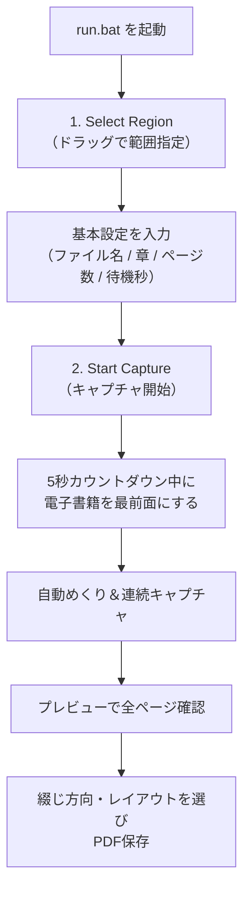

# eBook to PDF Converter 📚✨

[](https://www.python.org/)
[](https://www.microsoft.com/)

電子書籍の画面を自動でキャプチャし、高品質なPDFへと変換・結合するWindows向けデスクトップツールです。

---

## ⚡ クイックスタート（起動方法）

**[`run.bat`](file:///C:/Users/climb/Documents/EBOOK/run.bat) をダブルクリックするだけ**でアプリが起動します。  
コマンドプロンプトやターミナルを開く必要はありません。

※ コマンドラインから起動したい場合は以下でも可能です：
```bash
python app.py
```

---

## 📂 ミニマルな構成

```text
EBOOK/
├── app.py       # アプリケーション本体（GUI）
├── run.bat      # ダブルクリック起動用バッチ
├── build.py     # exe化ビルドスクリプト
├── config.json  # 設定の自動保存ファイル
├── README.md    # 説明書
└── .gitignore   # Git設定
```

---

## ✨ 主な機能

- **🖱️ マウスドラッグで範囲指定**
  - ボタン1つで画面全体がオーバーレイ表示になり、キャプチャしたい電子書籍の範囲をドラッグで指定できます。
- **🖥️ マルチモニター & DPI完全対応**
  - Windowsの拡大倍率（125%、150%など）や複数モニター環境でも座標がズレません。
- **📖 プレビュー & PDF設定**
  - キャプチャ完了後、サムネイル一覧で全ページを確認。
  - **綴じ方向**（左綴じ/横書き、右綴じ/縦書き・漫画）や **表示レイアウト**（単一ページ、見開き）を選択して保存できます。
- **⚡ 自動ページめくり & 章番号インクリメント**
  - 自動でキー操作を行い連続キャプチャ。キャプチャ完了ごとに章番号が自動で `+1` されるため連続取り込みが快適です。
- **💾 設定の自動保存**
  - 範囲座標や入力値は `config.json` に自動保存され、次回起動時もそのまま再開できます。
- **🚨 緊急停止（Fail-Safe）**
  - マウスカーソルを画面の左上隅に素早く移動させると、即座に安全停止します。

---

## 🛠️ 初回セットアップ（必要な場合のみ）

Python環境に必要なライブラリが未インストールの場合は、ターミナルで以下を一度だけ実行してください。

```bash
pip install customtkinter pyautogui pillow pypdf
```

---

## 🚀 使い方



1. **`run.bat` をダブルクリック**してアプリを起動します。
2. **「1. Select Region」** をクリックし、電子書籍のページ表示領域をドラッグして囲みます（`Esc` でキャンセル可）。
3. **ファイル名・章・ページ数・待機時間** を確認・入力します。
4. **「2. Start Capture」** をクリックします。5秒のカウントダウン中に電子書籍を最前面にアクティブ化してください。
5. キャプチャ完了後、開いたプレビュー画面でページを確認し、**「💾 保存場所を指定してPDF保存」** で完了です。

---

## 📦 スタンドアロンEXEの作成 (`build.py`)

Pythonのない別のPCでも動かせる `.exe` ファイルを作成したい場合は、以下を実行します：

```bash
pip install pyinstaller
python build.py
```
ビルドが完了すると、`dist/` フォルダ内に `eBookToPDF.exe` が生成されます。

---

## ⚠️ トラブルシューティング

* **起動しない場合**:
  - `run.bat` を実行した際にエラーが表示された場合は、必要なライブラリ（`pip install customtkinter pyautogui pillow pypdf`）がインストールされているか確認してください。
* **途中で緊急停止したい**:
  - マウスカーソルを画面左上の角に勢いよく移動させてください。自動停止します。
